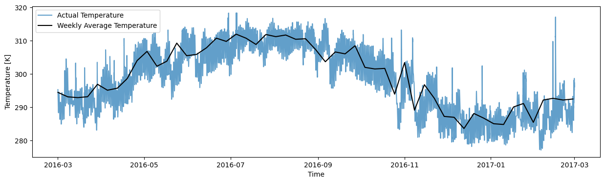
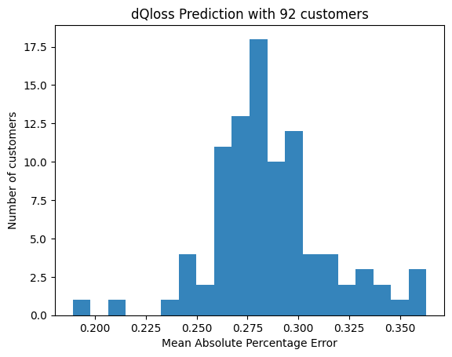
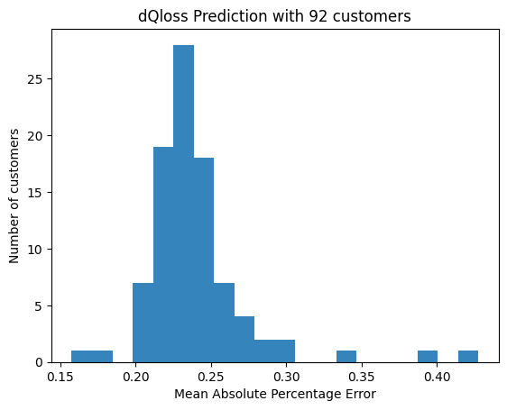
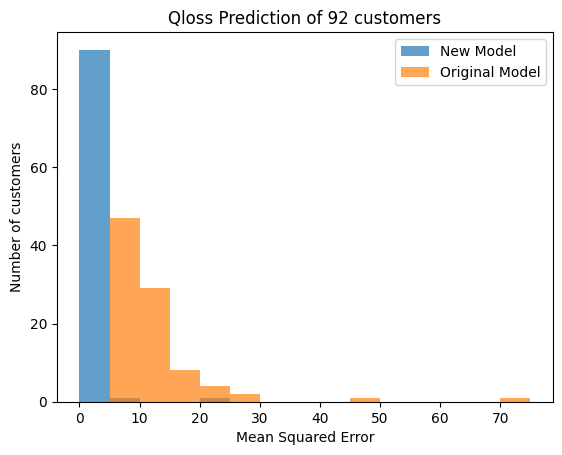
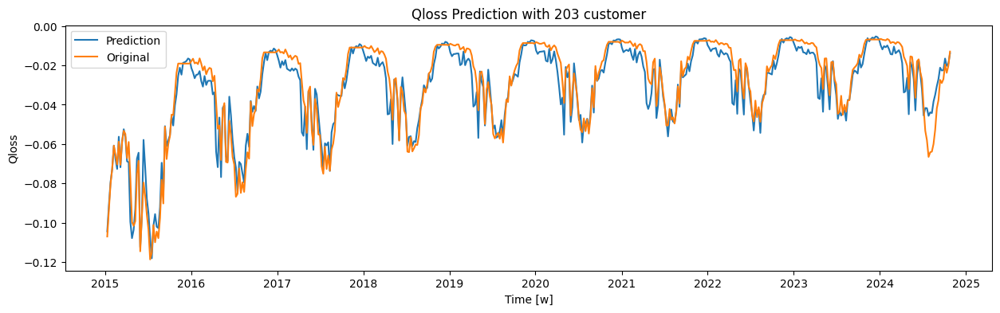
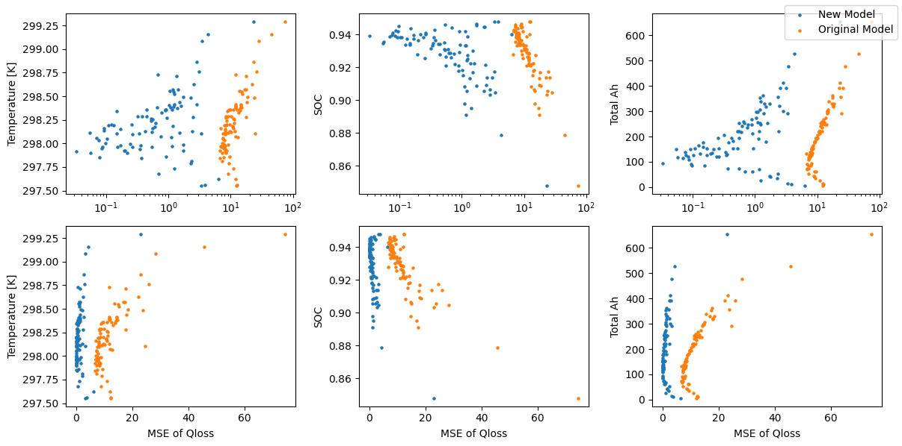

# Semi-empirical Aging Model for SOH prediction of EVs

## Project Overview
This repository documents a research project conducted during my internship at the **Center for Automotive Research (CAR)** at **The Ohio State University**, in collaboration with **Ford Motor Company**. The project focused on developing a semi-empirical model to predict the **State of Health (SOH)** of electric vehicle (EV) batteries, a critical component of Battery Management Systems (BMS). The goal was to estimate battery capacity fade over time to enable better durability assessment and operational safety for EVs.

Due to the proprietary nature of the collaboration, specific data and detailed model equations are not included in this repository. This README provides a high-level overview of the project’s objectives, methodology, and outcomes to showcase my contributions and technical skills.

## Problem Statement
Battery capacity in EVs degrades over time due to factors like calendar aging (time-based degradation) and cycling aging (degradation from charge-discharge cycles). Accurate SOH prediction is essential for:
- Estimating the operational range of EVs.
- Ensuring timely battery replacement for safety.
- Optimizing battery performance under varying conditions, such as temperature fluctuations.

The challenge was to create a model that balances physical accuracy with computational efficiency using real-world driving and environmental data while accounting for confidentiality constraints.

## Methodology
The project developed a semi-empirical aging model that combines physics-based principles with empirical data to predict weekly capacity fade. Key aspects of the methodology include:

### 1. Model Structure
The model accounts for two types of capacity fade:
- **Calendar Aging**: Reflects degradation over time since manufacturing.
- **Cycling Aging**: Reflects degradation due to Ampere-hour throughput during driving and charging cycles.

The model estimates capacity loss weekly using Battery Management System (BMS) data averaged over 7-day periods to capture seasonality and fluctuations without excessive noise. Ambient temperature is a critical factor in overall battery performance and life.

The proposed model builds upon **a baseline model from Cordoba-Arenas (2013)**, which calculates capacity fade for plug-in hybrid electric vehicles (PHEVs) assuming a constant temperature of 30°C. The baseline model is defined by the following equations:

$$ \begin{align} S_{loss,cyc}(Ah) = a_c() \cdot \exp\left(\frac{-E_{ac}}{R_u T}\right) \cdot Ah^z,\quad S_{loss,cld}(t) = a_c() \cdot \exp\left(\frac{-E_{ac}}{R_u T}\right) \cdot t^z \end{align} $$

$$ a_c(*) = a_c + \beta_c \cdot (Ratio)^b + \gamma_c \cdot (SOC_{min} - SOC_0)^c  $$

$$ Ratio = \frac{t_{cd} \cdot t_{cp} + t_{cs}}{t_{cd} + t_{cs}} $$

### 2. Data Utilization
The model was trained and tested using **10 years of simulated Battery Management System (BMS) data** from 274 customer profiles (182 training, 92 test sets), discretized into weekly intervals, and temperature data reflecting seasonal and daily variations. 

The figure below illustrates the weekly averaged temperature data used in the model, showing seasonal trends (e.g., summer peaks, winter lows) with reduced noise compared to raw data.

  

### 3. Parameter Optimization
- **Methods Compared**: Broyden-Fletcher-Goldfarb-Shanno (BFGS) optimization (via `scipy.optimize.minimize`) and Particle Swarm Optimization (PSO).
- **PSO Configuration**: 100 particles, 1000 iterations, cognitive parameter 0.3, social parameter 0.2, inertia parameter 0.9.
- **Calibration**: Seven model parameters were optimized using training data, evaluated on 92 test sets.
- **Results**

  BFGS achieved a Mean Absolute Percentage Error (MAPE) of 0.2836. Figure 2 shows a histogram of MAPE values for 92 test customers, with the distribution peaking around 0.2836, indicating moderate prediction accuracy but limited ability to capture fluctuations.

  
  
  PSO outperformed BFGS, achieving a lower MAPE of 0.2368. Figure 3 displays the MAPE distribution for 92 test customers, with ~30% below 0.225 and over 50% below 0.25, indicating strong optimization accuracy.

  

  The optimized parameters and MAPE results are summarized in Table 1 below.
- **Parameter Comparison**
  | Method | Param1 | Param2 | Param3 | Param4 | Param5 | Param6 | Param7 | MAPE |
  |--------|--------|--------|--------|--------|--------|--------|--------|------|
  | BFGS   | -1746.41 | -137920 | 0.55 | -11600.92 | 11016.87 | 1.0 | 24644.41 | 0.2836 |
  | PSO    | -3352.43 | -33422.41 | 0.58 | -5587.31 | 7397 | 0.999 | 27091.64 | 0.2368 |

  *Table 1: Comparison of optimized parameters and MAPE for BFGS and PSO.*

## Results
The proposed model demonstrated strong performance for SOH prediction in EVs, outperforming the baseline model and effectively capturing real-world battery degradation patterns.
- **Model Comparison**: The proposed model achieved Mean Squared Errors (MSEs) concentrated between 0 and 5, compared to 5–15 for the baseline model. Figure 4 shows a histogram comparing MSEs of capacity fade predictions for both models, highlighting superior performance of the new model.

  

- **Prediction Accuracy**: Over 50% of test cases achieved a MAPE below 0.25, indicating robust SOH prediction accuracy. Figure 4 shows a line plot comparing predicted vs. actual capacity fade for a randomly selected customer, demonstrating close alignment with seasonal trends and small fluctuations.

  

- **Error Analysis**: Higher temperatures, lower SOC, and increased Ampere-hour throughput were associated with larger prediction errors. Figure 6 shows scatter plots (normal and log scale) of MSE vs. temperature, SOC, and Ampere-hour throughput for both models. The new model’s log-scale errors form a triangular distribution, while the original model’s errors vs. Ampere-hour throughput form a bow shape, suggesting distinct error patterns. 

  

## Key Contributions

- **Model Development**: Designed a semi-empirical model that incorporates temperature variability and weekly data aggregation.
- **Optimization**: Implemented and compared BFGS and PSO, demonstrating PSO’s superior ability to capture data fluctuations and seasonal trends.
- **Error Analysis**: Identified relationships between prediction errors and variables (temperature, SOC, Ampere-hour throughput), revealing insights for future refinements.
- **Collaboration**: Worked closely with Ford and CAR researchers to align the model with industry needs while adhering to data confidentiality requirements.

## Technical Skills
- **Programming**: Python for model development, optimization, and data analysis.
- **Optimization Techniques**: BFGS (via `scipy.optimize.minimize`), Particle Swarm Optimization.
- **Battery Modeling**: Semi-empirical modeling, calendar and cycling aging.
- **Data Analysis**: Error pattern analysis, statistical evaluation (MAPE, MSE).
- **Tools**: MATLAB/Simulink (assumed for vehicle simulation), Python libraries (NumPy, SciPy for optimization, Matplotlib for visualization).

## Repository Contents
Due to confidentiality, this repository does not include:
- Proprietary datasets or specific equations.
- Detailed code implementations or parameter values.

Instead, it contains:
- This README, which summarizes the project.

## Acknowledgements
- **Center for Automotive Research, The Ohio State University** for providing research facilities and guidance.
- **Ford Motor Company** for collaboration and industry insights.
- Project advisors and team members for their support.

## References
- Cordoba-Arenas, A. (2013). Aging Propagation in Advanced Battery Systems: Preliminary Results.
- Naumann, M. (2018). Analysis and modeling of calendar aging of a commercial /graphite cell.
- Lin, S. (2008). Particle swarm optimization for parameter determination and feature selection of support vector machines.

##
*Note: This project is part of my portfolio to demonstrate my experience in battery modeling and optimization. For inquiries about the project or collaboration opportunities, please contact me via edenwldms@gmail.com*
